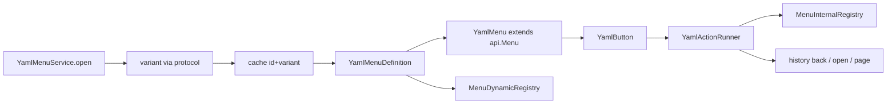

# Fase R4 — Menús YAML modern/legacy

## Decisiones fijas
- Variante: `ProtocolVersions.isLegacy(clientProtocols.protocol(player))` (≤340 → `menus/legacy/`, >340 → `menus/modern/`). Sin knob YAML.
- Sin carpeta `menus/logic/`: acciones/requisitos viven en cada variante (ficheros independientes).
- Textos decorativos (`NAME`/`LORE`) en el YAML del menú (estilo IoriCTW / refs design); `[message]` y `NAME-KEY`/`LORE-KEY` usan `CoreLanguage.rawFor/listFor`.
- Comentario en cabecera modern: *1.13–1.15 reciben modern (protocol >340); materiales 1.16+ con `MATERIAL-FALLBACK`.*
- Motor sobre framework B (`menu.api.Menu` + `Button`); framework A (`menu.Menu` inventory menus) se retira de ranks/settings/coinshop; `staff-mode.yml` sigue siendo hotbar (no inventario) leído por el mismo loader.
- Enums ya creados en [`menu/enums/`](bukkit/src/main/java/us/iorilabs/bukkit/menu/enums/) se usan tal cual.

## Arquitectura



### Paquete nuevo `us.iorilabs.bukkit.menu.api.yaml`
| Clase | Rol |
|---|---|
| `YamlMenuService` | load ambas carpetas, cache `id\|variant`, `reload()`, `open(player,id,ctx)`, `variant(player)`, `definition(player,id)` |
| `YamlMenuDefinition` | ID, TITLE, ROWS/TYPE, FILLER/BORDER, ITEMS, DYNAMIC, PAGINATION, SOUND, UPDATE-INTERVAL |
| `YamlMenuItemDef` | SLOT(S), MATERIAL(+fallback), DATA, CMD, AMOUNT, NAME/LORE, GLOW, ENCHANTS, FLAGS, SKULL, VIEW/CLICK-REQUIREMENTS, ACTIONS, DENY-ACTIONS |
| `YamlSlotParser` | int / lista / `'10-16'` / `'1-5,7'` |
| `YamlItemFactory` | ItemStack + skull owner/base64/self + glow/enchants/flags + CMD reflection-safe |
| `YamlMenu` / `YamlButton` | render + click → requirements → actions |
| `YamlAction` / `YamlActionRunner` | `[player]` `[console]` `[message]` `[open]` `[back]` `[close]` `[sound]` `[internal]` `[refresh]` `[permission]` + page |
| `YamlRequirement` | permission / compare / boolean (VIEW + CLICK + DENY-ACTIONS) |
| `YamlPlaceholders` | `{player}` + mapa ctx + soft PAPI (mismo patrón que `ChatFormatService`) |
| `YamlMenuSession` | historial back (Deque id+ctx), página por menú, ctx activo |
| `MenuInternalRegistry` / `MenuDynamicRegistry` | handlers `[internal:id]` y `DYNAMIC.SOURCE` |

### Cableado
- [`IoriCorePlugin`](bukkit/src/main/java/us/iorilabs/bukkit/IoriCorePlugin.java): crear `YamlMenuService`, `MenuApi.enable`, registrar internals tras `modules.enableAll`; `reloadCore()` → `yamlMenus.reload()` + `sounds.load()`.
- [`MenuColors`](bukkit/src/main/java/us/iorilabs/bukkit/menu/MenuColors.java): `title(Player,String)` recorta a 32 si `ProtocolProbe.protocol(player) ≤ 340` (no solo server).
- Retirar `new MenuConfig(plugin)` de Ranks/Settings/Coinshop/StaffMode; hotbar staff usa `yamlMenus.definition(player,"staff-mode")` (slots/material/data). Mantener API mínima tipo `MenuConfig` solo si hace falta como fachada delgada sobre definitions (preferible: métodos en `YamlMenuService` / definition).

## Schema YAML (ambos variants)
Cabecera `# ***` / secciones `# ────`. Claves UPPERCASE:

```yaml
ID: settings
TITLE: "&8Settings"
ROWS: 3
TYPE: CHEST
SOUND: { OPEN: UI-CLICK, CLICK: UI-CLICK, DENY: DENY }
FILLER: { MATERIAL: ..., DATA: 0, NAME: " ", GLOW: false }
BORDER: true
ITEMS:
  SOUNDS:
    SLOT: 11
    MATERIAL: NOTE_BLOCK
    NAME: "&eSounds"
    LORE: ["&7Click…"]
    GLOW: false
    VIEW-REQUIREMENTS: []
    ACTIONS:
      ANY: ["[open] settings-sounds"]
    CLICK-REQUIREMENTS: []
    DENY-ACTIONS: ["[sound] DENY", "[message] GENERAL.NO-PERMISSION"]
DYNAMIC:
  SOURCE: ranks.all
  SLOTS: ["10-16", "19-25", "28-34", "37-43"]
  TEMPLATE: { MATERIAL: NAME_TAG, NAME: "...", LORE: [...], ACTIONS: { LEFT: ["[open] rank-edit {id}"] } }
PAGINATION: { PREV: 48, NEXT: 50, INFO: 49 }
```

Acciones: string `[tipo] arg` (estilo refs HonlyCraft). `[permission] node` como gate inline; `[internal] ranks.toggle-bold {id}`.

## Internals + providers a registrar
- **settings.*** — open toggles/lang, toggle premium, password anvil (lógica actual de `SettingsMenu`).
- **ranks.*** — open edit/parents, cycle-color, toggles, anvil set-* (extraer de `RankEditMenu`).
- **coinshop.*** — open category/confirm, purchase (de `Coinshop*Menu`).
- **kits.give** — `KitService.give` + mensajes cooldown/perm.
- **staff.freeze / staff.teleport / staff.invsee-readonly** — vía `StaffModeService.freeze()` / teleport / open target inv read-only (sin editar; cancel clicks si se abre inv crudo, o solo mostrar info en menú).

Providers:
- `ranks.all` — lista `Rank` + placeholders actuales.
- `coinshop.offers` — por tipo TAG (ctx).
- `kits.enabled` — `KitService.names()` + perm/cooldown state.

## YAML a reescribir / añadir
Reescribir todos en [`bukkit/src/main/resources/menus/modern/`](bukkit/src/main/resources/menus/modern/) y [`legacy/`](bukkit/src/main/resources/menus/legacy/) con estilo IoriCTW + ACTIONS:
- settings, settings-sounds, settings-particles, settings-lang
- rank-list, rank-edit, rank-parents
- coinshop, coinshop-tags, coinshop-confirm
- staff-mode (hotbar; sin ACTIONS de inventario)
- **nuevos:** `kits.yml`, `staff-inspect.yml` (ambos variants)

## Callers
- `SettingsCommand` / `CoinshopCommand` / `RanksCommand` → `yamlMenus.open(player, id)`.
- Clases `*Menu` Java de inventory: eliminar o dejar 1-liner deprecado que delega (preferible eliminar y mover lógica a `menu.api.yaml.internal.*`).
- `KitCommand` args vacíos → abrir `kits` (si hay kits); con args sigue give directo.
- `StaffModeListener.inspect` → `yamlMenus.open(staff, "staff-inspect", {target})` en lugar de `target.getInventory()`.

## Cierre
- `npx prettier` sobre Java/YAML tocados + aires Darling.
- `gradlew.bat :bukkit:compileJava --no-daemon` (o `:bukkit:shadowJar` si hace falta classpath).
- Deploy jar Core solo si el cierre de tarea lo exige la regla 70 (sí tras cambios de código).
